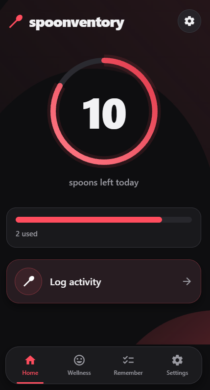
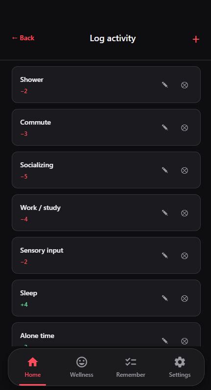
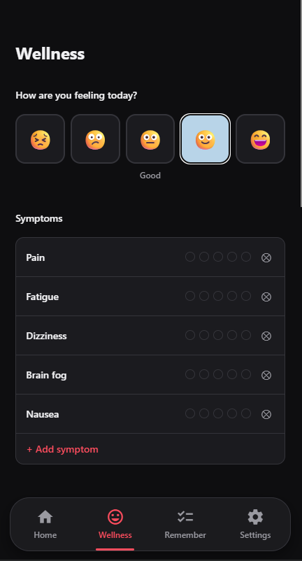
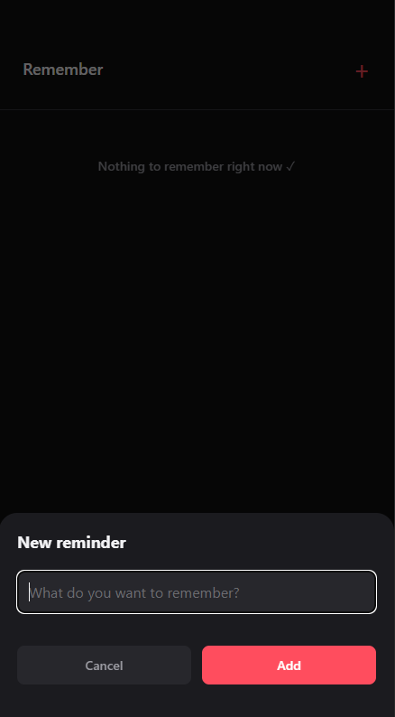

# Spoonventory

A mobile app for keeping track of your energy using [spoon theory](https://en.wikipedia.org/wiki/Spoon_theory). You get a daily ration of spoons, log activities that take or give spoons, and follow how you feel over time. It is built with React Native and Expo and runs on Android, iOS and the web.

## Preview

  
  
  
  

## Content

| Screen       | Content                                                                                         |
| ------------ | ----------------------------------------------------------------------------------------------- |
| **Home**     | Spoons left today in a ring, spoons used and carryover to tomorrow                             |
| **Log activity** | Activities that take or give spoons. Tap to log, edit the values or add your own           |
| **Wellness** | Daily mood, symptoms with severity, medications, a note, a 7-day trend and a monthly calendar  |
| **Remember** | A simple list of things to remember                                                            |
| **Settings** | Account, 4-digit app lock, daily reminder notification, backup export/import, language and clearing all data |                                                |

## Tech stack

- [Expo](https://expo.dev) SDK 56 with [Expo Router](https://docs.expo.dev/router/introduction/) for file-based routing
- React Native and TypeScript
- `react-native-svg` for the spoon ring and the background shapes
- AsyncStorage for storing all data locally on the device
- `expo-notifications` for the daily reminder
- `expo-file-system`, `expo-sharing` and `expo-document-picker` for backups

## Code decisions

**All data stays on the device:** There is no backend. The account, spoons, activities and wellness logs are saved with AsyncStorage. Since the data only exists on one device, there is an export and import function in Settings so you can move it to a new phone.

**Spoons carry over between days:** When a new day starts the balance resets to the daily ration, but a surplus or deficit is carried over. If you gained more spoons than you spent you start the next day with extra, and if you went below zero you start with fewer. This is shown as "+2 tomorrow" or "-1 tomorrow" on the home screen.

**Crash warning:** Every day's usage is saved in a history that keeps the last 90 days. If you have spent more than your daily ration two or more days in a row, including today, the Wellness screen suggests that you rest.

**Typed translations:** All text lives in one translation file. The English and Spanish translations are typed against the keys of the Swedish one, so a missing translation becomes a TypeScript error instead of empty text in the app.

**Migrating old saved data:** Earlier versions saved the default activities with Swedish names. Saved data can be upgraded when it is loaded, so those names are renamed to English while activities the user created themselves are left as they are.

**Custom tab bar:** The floating, rounded tab bar is built with the components from `expo-router/ui` instead of the native tab bar, since the native one can't be styled like the design. That way it looks the same on Android, iOS and the web.

**Hashed password and code:** The password and the app lock code are never stored in plain text. They are hashed with SHA-256 through `expo-crypto` and compared as hashes when you log in or unlock.
